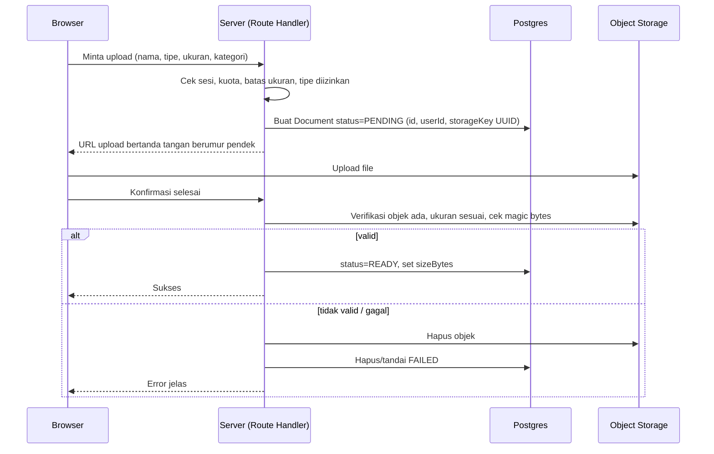
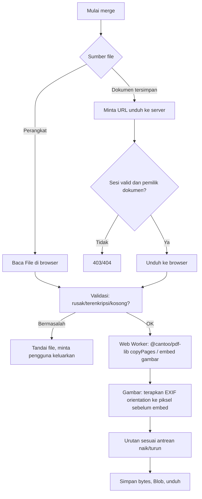

# FileMerge — Product Requirements Document (PRD)

| Item | Nilai |
|---|---|
| Versi | **0.3** (revisi arsitektur Prisma 8 + keputusan MVP) |
| Tanggal | 12 Oktober 2026 |
| Lisensi kode | MIT |
| Status | **Fase 1 (MVP merger) disetujui untuk diimplementasikan.** Fase 2+ ditahan menunggu keputusan database, autentikasi, dan storage. |

## Konvensi Status Informasi

Seluruh pernyataan ditandai salah satu label berikut.

- **[TERVERIFIKASI]**: berasal dari dokumen brief proyek atau diverifikasi langsung pada repository/dokumentasi resmi.
- **[ASUMSI]**: dugaan yang harus divalidasi.
- **[REKOMENDASI]**: usulan desain atau teknologi.
- **[BELUM DIVERIFIKASI]**: fakta provider (harga, kuota, fitur) yang wajib dicek di dokumentasi resmi pada Fase 0.

> **Pembaruan v0.3:** dokumen ini menyesuaikan PRD dengan **struktur repository aktual** dan **arsitektur Prisma 8 (contract-first)** yang benar-benar dipakai repo. Keputusan MVP ditetapkan: library PDF **@cantoo/pdf-lib**, pengaturan urutan **tombol naik/turun**, **drag-and-drop berbasis library ditunda**. Fase 2 dan seterusnya dinyatakan **menunggu keputusan** (database schema, auth, storage). Konfigurasi deployment yang wajib dipertahankan dicantumkan eksplisit di §17.

---

## Ringkasan Perubahan v0.2 → v0.3

| # | Section | Jenis | Ringkasan |
|---|---|---|---|
| 1 | Header | Update | Versi 0.3; status Fase 1 disetujui, Fase 2+ ditahan |
| 2 | §12.1 Fakta dasar | Update | Versi dependensi aktual; Prisma 8 **RC**; Composer **Early Access**; Compute **GA** |
| 3 | §12.3 Tanggung jawab | Koreksi | Client = `@prisma/orm-postgres` (bukan `@prisma/client`); tambah Composer |
| 4 | §13 Database Schema | **Rewrite** | Contract-first; schema target `Document`/`MergePreset`; command migrasi Prisma 8 |
| 5 | §14 Autentikasi | Tambah risiko | Kompatibilitas auth vs Prisma 8 RC belum terbukti |
| 6 | §15 Storage | Update | **Prisma Object Store bucket** jadi kandidat utama |
| 7 | §7.5 FR-MG-06 | Klarifikasi | pdf-lib **tidak** membaca EXIF; wajib rotate ke pixel |
| 8 | §7.5 FR-MG-02 | Keputusan | Tombol naik/turun untuk MVP; DnD ditunda |
| 9 | §8 NFR-08 | Koreksi | Prisma 8 belum punya `$extends` → pakai wrapper function |
| 10 | §17 Deployment | Update | Daftar konfigurasi wajib dipertahankan |
| 11 | §18 Testing | Update | Tooling test/lint konkret (repo saat ini nol) |
| 12 | §19 Acceptance | Update | AC-01..07 jadi gate rilis Fase 1 |
| 13 | §20 Fase | Update | Fase 2+ = gated, menunggu keputusan |
| 14 | §21 Risks | Tambah | R12–R15 (Prisma 8 RC, auth, pdf-lib, EXIF Safari) |

---

## 1. Executive Summary

FileMerge adalah aplikasi web open-source dan gratis untuk menggabungkan PDF dan gambar menjadi satu PDF, dengan opsi menyimpan dokumen pribadi (CV, KTP, KK, ijazah, sertifikat) di akun pengguna agar dapat dipakai ulang tanpa upload berulang.

Prinsip desain utama:

1. **Merge berjalan di browser** (@cantoo/pdf-lib). Server tidak memproses isi dokumen untuk merge dasar.
2. **Merge publik tanpa login**; login hanya untuk penyimpanan cloud.
3. **Metadata di Prisma Postgres, file di private object storage** (kandidat utama: Prisma Object Store bucket).
4. **Privasi dan isolasi data antar-akun** adalah requirement wajib, bukan fitur opsional.
5. **Biaya minimal**, tanpa janji layanan gratis tanpa batas.

Strategi rilis: **Fase 1 (merge publik, tanpa backend) dirilis lebih dulu** karena tidak bergantung pada keputusan auth dan storage. Fase 2+ ditahan sampai keputusan tersebut diambil.

---

## 2. Problem Statement

Pencari kerja dan pengurus administrasi berulang kali menggabungkan dokumen yang sama (KTP, KK, ijazah, transkrip) dengan satu dokumen yang berubah (CV). Alat yang ada umumnya mengharuskan upload ulang setiap kali, atau mengunggah dokumen sensitif ke server pihak ketiga tanpa kejelasan privasi.

## 3. Product Vision

Cara paling praktis dan privat untuk menyusun berkas administratif: simpan sekali, perbarui seperlunya, gabungkan kapan saja, dengan pemrosesan lokal di perangkat pengguna.

## 4. Goals and Non-Goals

### Goals
- G1. PDF merger praktis, tanpa login.
- G2. Penyimpanan dan penggunaan ulang dokumen per akun.
- G3. Isolasi data antar-akun dan kerahasiaan dokumen.
- G4. Biaya operasional minimal tanpa ketergantungan layanan berbayar.
- G5. Source code terbuka dan mudah dipelajari.

### Non-Goals
- Mengirim isi dokumen ke layanan AI atau pihak ketiga yang tidak diperlukan.
- Merge di server (kecuali keputusan baru di masa depan).
- Penyimpanan hasil merge otomatis di cloud.
- Kolaborasi multi-pengguna atau berbagi dokumen.
- OCR, tanda tangan digital, dan editing isi PDF (di luar rotasi/hapus halaman).
- Mengakali kebijakan provider (misalnya ping agar tidak tidur).
- Menjanjikan backup otomatis atau uptime tertentu.

## 5. Target Users dan Personas

**Pengguna utama:** individu yang sering mengurus dokumen administratif.
**Sekunder:** pelajar, mahasiswa, pencari kerja, profesional, pengguna umum.

| Persona | Deskripsi | Kebutuhan inti |
|---|---|---|
| Rina, pencari kerja | Melamar banyak lowongan, sering memperbarui CV | Ganti CV tanpa upload ulang, susun urutan cepat |
| Dimas, mahasiswa | Mengurus beasiswa, akses dari HP dan laptop | Akses lintas perangkat, UI mobile baik |
| Bu Sari, pengguna sesekali | Hanya butuh menggabungkan 3 file satu kali | Tanpa daftar akun, tanpa kerumitan |

Karakteristik: akses jarang, dokumen harus tetap tersedia walau lama tidak login, banyak data sensitif.

## 6. User Stories

| ID | Sebagai | Saya ingin | Agar |
|---|---|---|---|
| US-01 | Pengunjung | menggabungkan PDF tanpa login | cepat selesai tanpa akun |
| US-02 | Pengunjung | menyertakan gambar JPG/PNG dalam merge | foto dokumen menjadi halaman PDF |
| US-03 | Pengguna | mengatur urutan dengan tombol naik/turun (MVP) lalu drag-and-drop (lanjutan) | hasil sesuai kebutuhan |
| US-04 | Pengguna | mengunduh hasil dengan nama kustom | rapi untuk dikirim |
| US-05 | Pengguna | mendaftar dan login | menyimpan dokumen |
| US-06 | Pengguna login | mengunggah dan mengategorikan dokumen | mudah dicari |
| US-07 | Pengguna login | mengganti file CV saja | dokumen lain tidak tersentuh |
| US-08 | Pengguna login | memilih dokumen tersimpan untuk merge | tidak upload ulang |
| US-09 | Pengguna login | menghapus dokumen dan akun | mengontrol data saya |
| US-10 | Pengguna login | melihat sisa kuota | mengelola ruang |
| US-11 (lanjutan) | Pengguna login | menyimpan preset susunan | mengulang merge lamaran |

## 7. Functional Requirements

Prioritas: **P0** = MVP wajib, **P1** = penting, **P2** = lanjutan.

### 7.1 Landing Page
| ID | Pri | Deskripsi | Acceptance Criteria |
|---|---|---|---|
| FR-LP-01 | P0 | Penjelasan singkat, CTA "Mulai Merge", tombol login/registrasi, ringkasan fitur, info privasi dan open-source | Semua elemen tampil di desktop dan mobile; CTA membuka PDF Merger |
| FR-LP-02 | P0 | Navigasi responsif | Menu dapat dipakai dengan keyboard dan layar ≤ 375px |

### 7.2 Autentikasi
| ID | Pri | Deskripsi | Acceptance Criteria |
|---|---|---|---|
| FR-AU-01 | P1 | Registrasi email + password | Validasi format email dan kekuatan password; duplikat email ditolak dengan pesan aman. **Catatan Prisma 8: jangan andalkan kode error P2002 (belum tersedia) — pakai pre-check + penanganan unique constraint alternatif.** |
| FR-AU-02 | P1 | Login/logout, penanganan sesi | Sesi berakhir saat logout; cookie HttpOnly, Secure, SameSite |
| FR-AU-03 | P1 | Proteksi halaman dashboard | Akses tanpa sesi dialihkan ke login; API mengembalikan 401 |
| FR-AU-04 | P2 | Reset password | Hanya aktif jika layanan email terverifikasi |
| FR-AU-05 | P1 | Password tidak pernah plaintext | Hash (argon2id/bcrypt) atau dikelola provider; terbukti lewat review kode |
| FR-AU-06 | P0 | Merge dasar tanpa login | Fase 1 berfungsi tanpa sesi |

### 7.3 Dashboard
| ID | Pri | Deskripsi | Acceptance Criteria |
|---|---|---|---|
| FR-DB-01 | P1 | Ringkasan jumlah dokumen dan indikator kuota | Angka sesuai data di database |
| FR-DB-02 | P1 | Daftar, pencarian nama, filter kategori dan tipe | Hasil sesuai filter; hanya dokumen milik pengguna |
| FR-DB-03 | P1 | Info ukuran dan waktu upload; aksi detail, ganti, unduh, hapus | Semua aksi tersedia dan konsisten |
| FR-DB-04 | P1 | Empty, loading, error, dan success state | Setiap state tampil pada skenario terkait |

### 7.4 Manajemen Dokumen
| ID | Pri | Deskripsi | Acceptance Criteria |
|---|---|---|---|
| FR-DOC-01 | P1 | Upload PDF/JPG/JPEG/PNG dengan nama dan kategori (CV, Identitas, Pendidikan, Sertifikat, Lainnya) | Tersimpan dan muncul di daftar |
| FR-DOC-02 | P1 | Validasi tipe di server berdasarkan konten (magic bytes), bukan ekstensi | File berekstensi `.pdf` berisi konten lain ditolak |
| FR-DOC-03 | P1 | Batas ukuran file dan kuota per pengguna (nilai TBD sesuai provider) | Melebihi batas ditolak dengan pesan jelas |
| FR-DOC-04 | P1 | Ganti file secara aman | Upload baru berhasil dulu, baru metadata dialihkan, lalu file lama dihapus; jika gagal, file lama tetap utuh |
| FR-DOC-05 | P1 | Ubah nama dan kategori | Perubahan tersimpan tanpa menyentuh file |
| FR-DOC-06 | P1 | Hapus permanen dengan konfirmasi | Metadata dan objek terhapus; kegagalan sebagian ditangani (lihat 15.4) |
| FR-DOC-07 | P1 | Unduh dokumen via URL bertanda tangan berumur pendek atau stream terotorisasi | URL kedaluwarsa dan tidak bisa dipakai pengguna lain |
| FR-DOC-08 | P1 | Nama file disanitasi; key storage dibuat server (UUID) | Nama berbahaya atau path traversal tidak memengaruhi storage key |
| FR-DOC-09 | P1 | File tidak pernah publik secara default | Akses langsung URL storage tanpa tanda tangan ditolak |

### 7.5 PDF Merger
| ID | Pri | Deskripsi | Acceptance Criteria |
|---|---|---|---|
| FR-MG-01 | P0 | Pilih banyak PDF dan gambar dari perangkat | Multi-select dan drag-drop area berfungsi |
| FR-MG-02 | P0 | Atur urutan dengan **tombol naik/turun** (MVP) + alternatif keyboard | Urutan di UI = urutan halaman hasil. **Drag-and-drop berbasis library ditunda (P2).** |
| FR-MG-03 | P0 | Hapus dari antrean tanpa menghapus sumber | Sumber cloud tidak berubah |
| FR-MG-04 | P0 | Preview nama, tipe, urutan | Ditampilkan per item |
| FR-MG-05 | P0 | Gabung menjadi satu PDF di browser (**@cantoo/pdf-lib**) | Jumlah halaman hasil = jumlah halaman PDF sumber + jumlah gambar |
| FR-MG-06 | P0 | Gambar menjadi halaman dengan proporsi dan orientasi benar (**termasuk EXIF orientation**) | Gambar tidak terdistorsi atau terputar. **pdf-lib tidak membaca EXIF — orientasi harus diterapkan ke piksel (mis. `createImageBitmap(..., {imageOrientation:'from-image'})` + canvas) sebelum embed. Fallback untuk Safari wajib disiapkan.** |
| FR-MG-07 | P0 | Unduh dengan nama yang dapat diatur | Nama disanitasi; ekstensi `.pdf` |
| FR-MG-08 | P0 | Progres dan pesan error | Progres tampil; error spesifik per file |
| FR-MG-09 | P0 | Tangani file rusak, terenkripsi, kosong, tidak didukung | Aplikasi tidak crash; file bermasalah ditandai dan dapat dikeluarkan |
| FR-MG-10 | P0 | Tidak ada pengiriman isi dokumen ke server untuk merge | Verifikasi lewat panel Network: tidak ada upload isi file |
| FR-MG-11 | P1 | Memilih dokumen cloud untuk merge (diunduh ke browser, diproses lokal) | Hanya dokumen milik pengguna yang dapat dipilih |

### 7.6 Pengaturan Halaman (Lanjutan, P2)
Ukuran A4/Letter, margin, orientasi, fit-to-page, rotasi dan hapus halaman PDF. **Catatan:** default MVP (Fase 1) cukup A4 portrait dengan fit-to-page; sisanya Fase 5.

### 7.7 Riwayat dan Preset (Lanjutan, P2)
Preset susunan dokumen, template lamaran kerja, ulangi merge. Riwayat menyimpan **metadata** (dokumen apa, urutan, waktu), bukan salinan hasil merge, kecuali pengguna memilih eksplisit menyimpannya. **Catatan Prisma 8: filter kolom JSON belum tersedia — `MergePreset.items` hanya untuk simpan/baca, bukan query filter.**

## 8. Nonfunctional Requirements

| ID | Kategori | Requirement |
|---|---|---|
| NFR-01 | Performa | UI tetap responsif saat merge (Web Worker); progres terlihat; batas jumlah dan ukuran file ditentukan dari uji nyata |
| NFR-02 | Memori | Peringatan sebelum memproses total ukuran melebihi ambang hasil pengujian (TBD) |
| NFR-03 | Reliabilitas | Tidak ada metadata yang menunjuk ke objek yang tidak ada; retry upload/unduh dengan batas jelas |
| NFR-04 | Kompatibilitas | Desktop dan mobile; Chrome, Firefox, Safari, Edge versi modern |
| NFR-05 | Aksesibilitas | Navigasi keyboard dasar, fokus terlihat, kontras memadai (WCAG AA sebagai target) |
| NFR-06 | Biaya | Layanan gratis tanpa kartu kredit diprioritaskan; semua kuota didokumentasikan |
| NFR-07 | Logging | Tidak mencatat nama file sensitif atau isi dokumen |
| NFR-08 | Portabilitas | Penyedia storage dan auth diakses lewat lapisan abstraksi. **Catatan Prisma 8: `$extends` belum tersedia — abstraksi memakai wrapper function biasa, bukan Prisma client extensions.** |

## 9. MVP Scope dan Feature Priorities

**MVP = Fase 1.** Merge publik penuh di browser, tanpa database dan tanpa auth.

| Masuk MVP | Ditunda |
|---|---|
| Landing page, merge PDF + gambar, urutan via **tombol naik/turun**, unduh, penanganan error, UI responsif | Akun, dashboard, cloud storage (Fase 2–3) |
| A4 portrait + fit-to-page untuk gambar | Pilihan kertas, margin, orientasi, rotasi/hapus halaman (Fase 5) |
| Halaman Privacy Policy dasar | Preset, riwayat, split, kompresi (Fase 5) |
| — | Drag-and-drop berbasis library (P2, setelah MVP stabil) |

## 10. User Flows

1. **Merge publik:** Landing → PDF Merger → tambah file → atur urutan (naik/turun) → Gabungkan → Unduh.
2. **Registrasi/login:** Registrasi → (verifikasi email jika tersedia) → Login → Dashboard.
3. **Upload:** Dashboard → My Documents → Upload → nama + kategori → simpan → muncul di daftar.
4. **Merge dengan dokumen tersimpan:** PDF Merger → "Pilih dari dokumen saya" → pilih → atur urutan → Gabungkan → Unduh.
5. **Ganti CV:** My Documents → CV → Ganti file → pilih file baru → konfirmasi → dokumen lain tidak berubah.
6. **Hapus dokumen/akun:** Konfirmasi eksplisit → proses → status akhir ditampilkan.

## 11. UI/UX Requirements

- Desain minimalis, profesional, produktif; sidebar dashboard di desktop, navigasi sederhana (bottom/hamburger) di mobile.
- CSS sendiri (CSS Modules atau CSS biasa); hindari library UI besar tanpa manfaat jelas.
- **Drag-and-drop:** area drop file (HTML5 native) untuk menambah file tetap dipakai di MVP. **Pengurutan** memakai tombol naik/turun; DnD berbasis library (mis. dnd-kit) **ditunda** ke P2.
- Area upload drag-and-drop, daftar dokumen mudah dipindai, tombol aksi konsisten.
- Konfirmasi sebelum hapus; notifikasi sukses/gagal; empty state informatif.
- Hindari animasi berat.

**Daftar halaman:** Landing, Login, Registrasi, Dashboard, My Documents, PDF Merger, Account Settings, Privacy Policy, 404, Error.

## 12. Technical Architecture

### 12.1 Fakta dan asumsi dasar (diperbarui v0.3)

**Stack aktual repository [TERVERIFIKASI]:**

| Komponen | Versi | Catatan |
|---|---|---|
| Next.js | 16.2.7 | App Router; `output: "standalone"` |
| React / React DOM | 19.2.4 | |
| TypeScript | 5.9.3 | |
| Prisma CLI | 8.0.0-rc.12 | **Release Candidate** (GA diperkirakan Okt 2026) |
| @prisma/orm-postgres | 8.0.0-rc.8 | Client runtime (bukan `@prisma/client`) |
| @prisma/composer | 0.16.0 | **Early Access** — API bisa berubah |
| @prisma/composer-prisma-cloud | 0.16.0 | |
| Bun | 1.3.14 | Package manager + runtime deploy |
| Node (CI) | 24 | Prisma 8 butuh ≥22.18; line 24 butuh ≥24.11 |

- **[TERVERIFIKASI]** Project Next.js sudah dibuat dan deployment aktif di Prisma Compute (GA sejak 28 Agu 2026). Prisma Postgres sudah dibuat; connection string disimpan sebagai secret (tidak dicantumkan di dokumen/repo).
- **[TERVERIFIKASI]** Repository saat ini = template Prisma Compute (1 commit, bot). **Belum ada fitur FileMerge.** Yang ada: `User`+`Post` demo, route `/api/users`, seed alice/marie.
- **[BELUM DIVERIFIKASI]** Aplikasi sudah berhasil query `DATABASE_URL` dari kode di Compute; perlu query uji aman + pemeriksaan log (Fase 0).
- **[BELUM DIVERIFIKASI]** Batas runtime/ukuran request Prisma Compute; kuota free tier (pricing: Postgres 100k ops + 500 MB + 50 DB; Compute 1M request/bln, 360 GB-hrs memori, 4 vCPU-hrs, 10 GB egress/bln — angka belum diverifikasi di akun).
- **[TERVERIFIKASI]** Prisma **Object Store bucket** tersedia di setiap project: S3-compatible, per-bucket key (role `read`/`read_write`), **presigned URL** native (`Bun.s3.file(...).presign()`), bisa di-provision lewat Composer `bucket()`. Kuota/model akses bucket **belum diverifikasi** di akun.

### 12.2 Diagram arsitektur

```mermaid
flowchart LR
  U[Browser Pengguna]
  subgraph Browser
    UI[Next.js UI - React]
    PL[@cantoo/pdf-lib + Web Worker]
  end
  subgraph Compute[Prisma Compute - Next.js server]
    RH[Route Handlers / Server Actions]
    AZ[Authz: cek sesi + kepemilikan]
  end
  AUTH[(Auth Provider / library - TBD)]
  DB[(Prisma Postgres - metadata)]
  OBJ[(Prisma Object Store bucket - TBD)]

  U --> UI
  UI --> PL
  UI -->|HTTPS| RH
  RH --> AZ
  AZ --> AUTH
  AZ -->|Prisma ORM 8| DB
  RH -->|presigned URL / kredensial server| OBJ
  UI -->|upload/unduh via URL bertanda tangan| OBJ
  PL -.->|merge lokal, tanpa kirim isi file| UI
```

### 12.3 Tanggung jawab komponen

| Komponen | Tanggung jawab | Bukan tanggung jawab |
|---|---|---|
| Browser/UI | Render, antrean merge, merge via @cantoo/pdf-lib, unduh hasil | Keputusan otorisasi |
| Route Handlers | Autentikasi sesi, otorisasi, validasi, penerbitan URL bertanda tangan, operasi metadata | Memproses merge |
| Prisma ORM 8 (`@prisma/orm-postgres`) | Akses dan migrasi data | Auth atau storage |
| Prisma Postgres | Metadata terstruktur | Menyimpan isi file |
| **Prisma Composer** | Deklarasi & provisioning service/DB/bucket; deploy | Logika bisnis |
| Auth | Identitas, sesi, hash password | Otorisasi dokumen |
| Object Storage (Prisma bucket) | Menyimpan file privat | Logika bisnis |
| @cantoo/pdf-lib | Merge, embed gambar | Dekripsi PDF terproteksi |

### 12.4 Alur Upload


Catatan: Prisma bucket mendukung presigned URL (Opsi A). Fallback upload via server tetap tersedia (Opsi B). Dokumen PENDING lebih tua dari ambang (TBD) dibersihkan job pembersih.

### 12.5 Alur Merge (Fase 1 — murni browser)



### 12.6 Alur lain (ringkas)
- **Registrasi/login:** form → server validasi → provider auth → cookie sesi → redirect. Titik gagal: email duplikat (lihat FR-AU-01, tanpa P2002), rate limit, provider down.
- **Ambil dokumen:** cek sesi → query `WHERE id AND userId` → URL bertanda tangan pendek → unduh. Dokumen milik orang lain mengembalikan 404 (bukan 403) agar tidak membocorkan keberadaan.
- **Ganti dokumen:** upload objek baru (key baru) → verifikasi → transaksi DB mengalihkan `storageKey` → hapus objek lama (jika gagal, catat untuk pembersihan).
- **Hapus dokumen:** lihat 15.4.
- **Hapus akun:** konfirmasi password/sesi baru → daftar semua objek pengguna → hapus objek → hapus baris DB (cascade) → hapus identitas di auth → logout. Jika sebagian gagal, akun ditandai `PENDING_DELETION` dan dicoba ulang.

---

## 13. Database Schema (REWRITE — Prisma 8 contract-first)

**[TERVERIFIKASI]** Repo memakai **Prisma 8 contract-first**, bukan `schema.prisma` + `@prisma/client`:

- Sumber schema: `src/prisma/contract.prisma`
- Alur: `bun run contract:emit` → `bun run migration:plan --name <desc>` → `bun run db:init` (awal) / `bun run db:update` (perubahan)
- Client runtime: `@prisma/orm-postgres` (`src/prisma/db.ts`); akses namespace-qualified `db.orm.public.<Model>`
- **`prisma migrate deploy` TIDAK berlaku** untuk repo ini (koreksi dari PRD v0.2)

**Schema demo saat ini [TERVERIFIKASI]:** `User` (id **Int autoincrement**, email, username?, name?) + `Post`. **Tidak ada** Document/MergePreset/enum.

**[REKOMENDASI]** Schema target Fase 2+ (ditulis dalam bentuk contract Prisma 8; field disesuaikan saat Fase 2 dimulai):

```prisma
// src/prisma/contract.prisma (target Fase 2+)
// use prisma-next

enum DocCategory { CV IDENTITAS PENDIDIKAN SERTIFIKAT LAINNYA }
enum DocStatus   { PENDING READY FAILED PENDING_DELETION }

model User {
  id        String   @id @default(cuid())
  email     String   @unique
  // passwordHash hanya jika auth dikelola sendiri via library
  createdAt DateTime @default(now())
  updatedAt temporal.updatedAt()
  documents Document[]
  presets   MergePreset[]
}

model Document {
  id          String      @id @default(cuid())
  userId      String
  user        User        @relation(fields: [userId], references: [id])
  displayName String
  category    DocCategory @default(LAINNYA)
  mimeType    String
  sizeBytes   Int
  storageKey  String      @unique
  status      DocStatus   @default(PENDING)
  createdAt   DateTime    @default(now())
  updatedAt   temporal.updatedAt()
}

model MergePreset {
  id        String   @id @default(cuid())
  userId    String
  user      User     @relation(fields: [userId], references: [id])
  name      String
  items     Json     // [{documentId, order}] — referensi, bukan salinan file
  createdAt DateTime @default(now())
}
```

**Catatan penting Prisma 8 RC (dampak desain):**
- `updatedAt` memakai `temporal.updatedAt()` (helper Prisma 8), bukan `@updatedAt`.
- **`onDelete: Cascade` belum terverifikasi tersedia** di RC → penghapusan anak (Document) harus dilakukan eksplisit oleh server sampai diverifikasi (lihat §15.4).
- **Filter kolom JSON belum tersedia** → `MergePreset.items` tidak bisa di-query filter.
- **Atomic increment belum tersedia** → penghitungan kuota jangan andalkan `increment`; gunakan transaksi/pola aman (isolation level belum tersedia).
- **Kode error P2002 belum tersedia** → deteksi duplikat email pakai pre-check + penanganan constraint alternatif.
- **`$extends` belum tersedia** → abstraksi pakai wrapper function.
- Objek storage **tidak ikut terhapus otomatis**; penghapusan objek eksplisit oleh server.

Semua item di atas **wajib diverifikasi ulang saat Fase 2 dimulai** (versi Prisma bisa sudah GA).

---

## 14. Authentication and Authorization

### 14.1 Opsi autentikasi (evaluasi, belum diputuskan — DITAHAN)

| Opsi | Kelebihan | Risiko / hal yang harus diverifikasi |
|---|---|---|
| Auth.js (NextAuth) + Prisma Adapter + credentials | Open-source, tanpa biaya, kompatibel Next.js | **Prisma Adapter mengasumsikan `@prisma/client`; kompatibilitas dengan `@prisma/orm-postgres` Prisma 8 RC BELUM TERBUKTI** |
| Better Auth | Open-source, email+password | Kematangan & kebijakan keamanan perlu dicek; **dukungan Prisma 8 RC belum terbukti** |
| Layanan terkelola (Clerk, Supabase Auth) | Fitur lengkap | Kuota gratis, kartu kredit, retensi: [BELUM DIVERIFIKASI]; ketergantungan vendor |

**🔴 RISIKO KRITIS:** Prisma 8 RC memakai client baru (`@prisma/orm-postgres`). Library auth pihak ketiga umumnya menargetkan `@prisma/client`. **Wajib spike Fase 0** sebelum memilih. Fallback: (a) tunggu Prisma 8 GA, (b) pin `prisma@7` untuk produksi, atau (c) auth self-hosted tanpa adapter Prisma (kelola sesi/hash sendiri).

**[REKOMENDASI]** Tunda keputusan sampai Fase 0 selesai. Jangan commit ke library mana pun sebelum ada PoC yang jalan.

### 14.2 Otorisasi
- Semua endpoint dokumen: ambil `userId` dari sesi server, **bukan** dari body/query.
- Query selalu menyertakan `userId` (`findFirst({ where: { id, userId } })`).
- Respons 404 untuk dokumen bukan milik pengguna.
- Storage key UUID **tidak** dianggap sebagai kontrol akses.
- Kontrol berbasis tombol/halaman frontend tidak dihitung sebagai keamanan.

---

## 15. File Storage Strategy

### 15.1 Kandidat

| Kandidat | Status | Catatan |
|---|---|---|
| **Prisma Object Store bucket** | **[TERVERIFIKASI ada]** | S3-compatible, di project yang sama, per-bucket key (`read`/`read_write`), **presigned URL native**, branch-aware, bisa di-provision via Composer `bucket()`. **Kandidat utama.** Kuota/model akses [BELUM DIVERIFIKASI] |
| Cloudflare R2 | [BELUM DIVERIFIKASI] | Kompatibel S3 + presigned URL; cek kartu/kuota |
| Supabase Storage | [BELUM DIVERIFIKASI] | Bucket privat + signed URL; kebijakan pause, kuota |
| Backblaze B2 | [BELUM DIVERIFIKASI] | Kompatibel S3; syarat & kuota |
| Vercel Blob / UploadThing | [BELUM DIVERIFIKASI] | Model akses (publik/privat), kecocokan hosting non-Vercel |

**Kriteria seleksi:** bucket privat, signed URL berumur pendek, tanpa kartu kredit (diprioritaskan), kuota memadai, retensi jelas, S3-compatible. **[REKOMENDASI]** Prisma bucket menang karena satu platform + presigned URL + tanpa provider kedua.

### 15.2 Opsi implementasi
- **A (disukai):** presigned URL — browser upload/unduh langsung ke bucket.
- **B (cadangan):** upload/unduh melalui route handler — lebih sederhana tetapi memakai kuota/bandwidth Compute dan terikat batas ukuran request.

### 15.3 Kuota dan batas
Batas ukuran per file, kuota per pengguna, dan jumlah dokumen maksimum ditetapkan setelah kuota provider diketahui. **[ASUMSI awal]**: 10 MB per file, 50 MB per pengguna, 30 dokumen. ⚠️ Free tier Prisma Postgres = 500 MB storage (DB), sedangkan file di bucket terpisah — kuota bucket perlu dicek. Total kuota semua pengguna harus < kapasitas gratis.

### 15.5 Batas Fase 1 (TERVERIFIKASI lewat benchmark)
Batas berikut diukur nyata di Chromium headless (lihat `docs/Fase1-Report.md` §4) dan dipakai di `src/lib/limits.ts`:

| Konstanta | Nilai | Dasar |
|---|---|---|
| `MAX_FILE_BYTES` | 50 MB | ditolak di intake (diuji dengan file 51 MB) |
| `MAX_TOTAL_BYTES` | 200 MB | 200.7 MB / 35 file diproses sukses (1.3 s) |
| `MAX_FILES` | 50 | batas antrean |
| `WARN_TOTAL_BYTES` | 120 MB | peringatan lunak, bukan penolakan |

Batas ini berlaku untuk merge di browser (Fase 1) dan tidak bergantung pada kuota provider storage.

### 15.4 Konsistensi dan kegagalan
- Upload: PENDING → upload → verifikasi → READY (lihat 12.4).
- Hapus: set `PENDING_DELETION` → hapus objek → hapus baris. Jika hapus objek gagal, baris tetap `PENDING_DELETION` dan dicoba ulang; jika hapus baris gagal setelah objek terhapus, retry hapus baris (idempoten). Dokumen `PENDING_DELETION` disembunyikan dari UI.
- **Karena `onDelete: Cascade` belum terverifikasi di Prisma 8 RC**, penghapusan anak dilakukan eksplisit (bukan mengandalkan cascade).
- Job rekonsiliasi berkala (mekanisme penjadwalan di Compute [BELUM DIVERIFIKASI]; alternatif: dijalankan saat login/aksi atau skrip manual).
- Backup: **tidak ada janji backup otomatis**. Sediakan fitur unduh semua dokumen.
- Retensi: dokumen disimpan sampai dihapus pengguna; kebijakan akun tidak aktif = keputusan terbuka.

---

## 16. Security and Privacy

| ID | Requirement | Verifikasi |
|---|---|---|
| SEC-01 | Isolasi data per pengguna di semua endpoint | Tes otorisasi A→B |
| SEC-02 | Autentikasi aman, cookie HttpOnly/Secure/SameSite | Review + tes |
| SEC-03 | Bucket privat, URL bertanda tangan berumur pendek (menit) | Akses URL tanpa tanda tangan/kedaluwarsa ditolak |
| SEC-04 | Secret hanya di env server; tidak ada prefiks `NEXT_PUBLIC_` untuk secret | Scan repo dan bundle |
| SEC-05 | `.env.example` tanpa nilai nyata; `.env` di `.gitignore` | Review, secret scanning |
| SEC-06 | Validasi ukuran, tipe (magic bytes), dan konten file di server | Tes file palsu |
| SEC-07 | Sanitasi nama file; key storage dibuat server | Tes `../../x.pdf` |
| SEC-08 | Rate limiting login/registrasi/upload (mekanisme [BELUM DIVERIFIKASI]; fallback berbasis tabel DB) | Tes beban kecil |
| SEC-09 | Proteksi CSRF untuk mutasi; header keamanan (CSP, X-Content-Type-Options, dsb.) | Review header |
| SEC-10 | Logging minimal; tanpa nama file/isi dokumen | Review log |
| SEC-11 | Hapus dokumen dan akun beserta data terkait | Tes uji penghapusan |
| SEC-12 | Kebijakan retensi, backup, pemulihan terdokumentasi dan tidak melebih-lebihkan | Review dokumen |
| SEC-13 | Enkripsi at-rest provider **tidak diasumsikan**; dicek dan didokumentasikan apa adanya | Fase 0 |
| SEC-14 | Dokumen asli (KTP/KK/ijazah) tidak dipakai saat pengujian; gunakan dokumen contoh | Aturan tim |
| SEC-15 | Lisensi MIT berlaku untuk kode saja, bukan izin mempublikasikan dokumen pengguna; dinyatakan di README dan Privacy Policy | Review dokumen |
| SEC-16 | **Fase 1: verifikasi tidak ada upload isi file ke server saat merge (panel Network)** | Tes manual |

Catatan jujur untuk Privacy Policy: dokumen di cloud **tidak dienkripsi end-to-end**; operator secara teknis dapat mengakses storage. Dinyatakan terang-terangan. Enkripsi sisi-klien = fitur lanjutan (konsekuensi: lupa password = data hilang).

---

## 17. Deployment and Cost Constraints

| Layanan | Kuota/harga | Status |
|---|---|---|
| Prisma Postgres | Free: 100k ops + 500 MB + 50 DB (pricing resmi) | [TERVERIFIKASI: database dibuat; kuota belum dicek di akun] |
| Prisma Compute | Free: 1M request/bln, 360 GB-hrs memori, 4 vCPU-hrs, 10 GB egress/bln (pricing resmi) | [TERVERIFIKASI: deployment aktif; kuota belum dicek di akun] |
| Prisma Composer | Early Access | [TERVERIFIKASI: Early Access, API bisa berubah] |
| Auth | TBD (Rp 0 jika self-hosted) | [BELUM DIVERIFIKASI] |
| Object storage (Prisma bucket) | TBD | [BELUM DIVERIFIKASI] |
| Email (reset password) | TBD | [BELUM DIVERIFIKASI] |

### 17.1 Konfigurasi yang WAJIB DIPERTAHANKAN (jangan diubah tanpa alasan kuat)

| File | Nilai wajib | Alasan |
|---|---|---|
| `next.config.ts` | `output: "standalone"` | Compute menjalankan standalone server; tanpa ini live URL 504 |
| `next.config.ts` | `outputFileTracingRoot`, `turbopack.root` | Root tracing/build |
| `module.ts` | `module("filemerge", …)`, `provision(postgres(...))`, `provision(service, {id:'web', deps:{db}})` | Deklarasi Composer |
| `src/service.ts` | `compute({name:'web', build: nextjs({module: import.meta.url, appDir:'..'})})` | Build adapter Next.js |
| `prisma-composer.config.ts` | `extensions: [prismaCloud(), nextjsBuild()], state: prismaState()` | Config Composer |
| `prisma.config.ts` | `contract: './src/prisma/contract.prisma'`, `db.connection: DATABASE_URL` | Config ORM |
| `.github/workflows/prisma-deploy.yml` | `prisma/cloud-deploy-action@v1`, `module: module.ts`, `build-command: bun run build`, `id-token: write` | CI deploy via OIDC |
| `bunfig.toml` | `linker = "hoisted"` | Composer butuh binary alchemy; build tidak boleh ada symlink |
| `package.json` | `"build": "bun run contract:emit && next build"`, `"start": "node .next/standalone/server.js"` | Urutan build + server standalone |
| `.gitignore` | `.env`, `.next`, `.prisma`, `.prisma-composer`, `.alchemy` | Cegah kebocoran secret & artefak |

**Aturan:** tidak ada perubahan konfigurasi deployment tanpa izin pemilik. Secret hanya di env server; tidak ada secret berprefiks `NEXT_PUBLIC_`.

---

## 18. Testing Strategy

**Tooling (sudah dipasang di Fase 1):**

| Tujuan | Alat | Status |
|---|---|---|
| Lint | `eslint@9` + `eslint-config-next@16.2.7` | ✅ terpasang, 0 error |
| Unit test | `vitest@5` | ✅ 26 tes lulus |
| E2E | `@playwright/test@1.64` (Chromium + Firefox) | ✅ 20 tes lulus |
| Typecheck | `tsc --noEmit` | ✅ exit 0 |
| Format | `prettier` | belum (ditunda) |
| Secret scan | `gitleaks` | belum (dijalankan manual sebelum rilis) |

- **Unit:** validasi file, sanitasi nama, util kuota, urutan merge (naik/turun).
- **Integrasi:** route handlers dengan DB uji & storage uji (bukan produksi).
- **Otorisasi:** A mencoba GET/PATCH/DELETE/unduh dokumen B → harus gagal; tanpa sesi → 401.
- **Kegagalan:** upload terputus, storage down saat hapus, DB down saat konfirmasi, ganti file gagal.
- **PDF:** rusak, terenkripsi, kosong, sangat besar, banyak halaman, **gambar EXIF-rotated (nilai 1–8)**, PNG transparan, JPG CMYK.
- **Lintas perangkat:** Chrome/Firefox/Safari, Android dan iOS.
- **Keamanan:** scan secret (gitleaks) di repo & bundle klien; cek header.
- **Aksesibilitas:** navigasi keyboard, kontras.
- Hasil pengujian **tidak dilaporkan berhasil sebelum benar-benar dijalankan**.

---

## 19. Acceptance Criteria

| ID | Kriteria | Fase | Gate |
|---|---|---|---|
| AC-01 | Pengguna dapat menggabungkan ≥ 2 PDF menjadi satu | 1 | **Rilis Fase 1** |
| AC-02 | Gambar menjadi halaman PDF dengan proporsi dan orientasi benar (termasuk EXIF) | 1 | **Rilis Fase 1** |
| AC-03 | Urutan halaman hasil sama dengan urutan antrean (naik/turun) | 1 | **Rilis Fase 1** |
| AC-04 | Hasil merge dapat diunduh dengan nama kustom | 1 | **Rilis Fase 1** |
| AC-05 | Merge dasar tidak memerlukan backend PDF; tidak ada upload isi file saat merge | 1 | **Rilis Fase 1** |
| AC-06 | File rusak/terenkripsi/kosong ditandai tanpa crash | 1 | **Rilis Fase 1** |
| AC-07 | Aplikasi berfungsi di desktop dan mobile | 1+ | **Rilis Fase 1** |
| AC-08 | Pengguna login dapat mengunggah dan melihat kembali dokumennya | 2 | Ditahan |
| AC-09 | Ganti CV tanpa mengubah dokumen lain; kegagalan ganti tidak menghilangkan file lama | 2–3 | Ditahan |
| AC-10 | Pengguna dapat memilih dokumen tersimpan untuk merge | 3 | Ditahan |
| AC-11 | Pengguna B tidak dapat membaca/mengunduh dokumen A | 4 | Ditahan |
| AC-12 | Dokumen tidak dapat diakses tanpa autentikasi/otorisasi valid; URL tanpa tanda tangan ditolak | 4 | Ditahan |
| AC-13 | Penghapusan menangani kegagalan DB dan storage tanpa dokumen yatim | 4 | Ditahan |
| AC-14 | Tidak ada secret di source code publik atau bundle klien | 4 | Ditahan |
| AC-15 | Kuota, retensi, dan risiko kehilangan data didokumentasikan | 4 | Ditahan |
| AC-16 | Hapus akun menghapus semua dokumen dan metadata terkait | 4 | Ditahan |

**Gate Fase 1:** AC-01 sampai AC-07 harus **lulus dan diuji** sebelum rilis Fase 1.

---

## 20. Development Phases

| Fase | Isi | Output / pintu keluar |
|---|---|---|
| **0 — Validasi platform** | Verifikasi query DB end-to-end; putuskan storage; spike auth vs Prisma 8 RC; cek kuota free tier | **✅ Selesai** — Prisma Postgres + Vercel Blob private + auth self-managed |
| **1 — MVP merger publik** | Landing, merge PDF + gambar (@cantoo/pdf-lib), urutan naik/turun, unduh, error handling, responsif, a11y | **✅ AC-01–07 lulus (docs/Fase1-Report.md) — LIVE** |
| **2 — Akun & storage** | Registrasi/login, dashboard, upload, kategori, pencarian, private storage, kontrol akses | **✅ Selesai (docs/Fase2-4-Report.md)** — AC-08 lulus |
| **3 — Integrasi dokumen tersimpan** | Pilih dokumen cloud untuk merge | **✅ Selesai** — AC-09, AC-10 lulus |
| **4 — Keamanan & stabilisasi** | Tes otorisasi, kegagalan, PDF rusak, scan secret, lintas perangkat | **✅ Selesai** — AC-11–16 lulus (kecuali Safari/iOS belum diuji) |
| **5 — Lanjutan** | Pengaturan halaman, drag-and-drop urutan, preset susunan | **✅ Selesai (docs/Fase5-Report.md)** — sisanya (rotasi/split/kompresi) opsional |

**Status:** Fase 0–5 selesai & LIVE di https://filemerge-seven.vercel.app.

Dokumen repo yang direncanakan: `README.md`, `LICENSE` (MIT), `CONTRIBUTING.md`, `SECURITY.md`, `.env.example`, panduan instalasi lokal, panduan deployment, dokumentasi arsitektur, Privacy Policy.

---

## 21. Risks and Mitigations

| # | Risiko | Dampak | Mitigasi |
|---|---|---|---|
| R1 | Tidak ada storage gratis tanpa kartu kredit | Fase 2 tertunda | Rilis Fase 1 lebih dulu; Prisma bucket sebagai kandidat utama; abstraksi storage |
| R2 | Kuota Compute/DB/storage habis | Layanan akun tidak tersedia | Presigned URL, kuota per pengguna, monitoring, merge publik tetap jalan |
| R3 | Kebocoran dokumen akibat bug otorisasi | Sangat tinggi | Query terikat `userId`, tes otorisasi wajib, tinjauan kode |
| R4 | Kehilangan data (provider gagal / tidak ada backup) | Tinggi | Komunikasi jujur, fitur unduh semua dokumen |
| R5 | Browser kehabisan memori pada file besar | Merge gagal | Batas dari uji nyata, Web Worker, pesan jelas |
| R6 | PDF terenkripsi/rusak | Merge gagal | Deteksi dini, tandai file, pengguna bisa keluarkan |
| R7 | Penyalahgunaan (spam upload) | Kuota habis | Rate limit, kuota, validasi tipe, privat |
| R8 | Auth buatan sendiri tidak aman | Akun diambil alih | Library teruji, hash kuat, rate limit |
| R9 | Ekspektasi privasi berlebih | Reputasi/legal | Privacy Policy jujur (tidak E2E), opsi tanpa akun |
| R10 | Perbedaan perilaku Safari/iOS | UX rusak | Uji perangkat nyata; **fallback orientasi gambar Safari** |
| R11 | Kewajiban hukum data pribadi (UU PDP) | Kepatuhan | Konsultasi hukum; kebijakan privasi, penghapusan, kontak pelaporan |
| **R12** | **Prisma 8 masih RC (GA diperkirakan Okt 2026); API bisa berubah** | **Breaking change saat upgrade** | **Pin versi; isolasi akses DB di satu modul; jadwalkan re-verify saat GA; pertimbangkan `prisma@7` untuk produksi** |
| **R13** | **Kompatibilitas library auth dengan Prisma 8 RC (`@prisma/orm-postgres` vs `@prisma/client`) belum terbukti** | **Fase 2 terblokir / auth tidak aman** | **Spike Fase 0; fallback: tunggu GA, pin Prisma 7, atau auth self-hosted tanpa adapter Prisma** |
| **R14** | **pdf-lib upstream tidak di-maintain; dipilih fork @cantoo/pdf-lib** | **Bug tak diperbaiki / risiko supply-chain** | **Pin versi; pantau fork; siapkan jalur migrasi ke upstream bila aktif lagi; lockfile commit** |
| **R15** | **EXIF orientation tidak dibaca pdf-lib; Safari/iOS bisa beda perilaku** | **Foto miring di PDF (keluhan utama)** | **Terapkan orientasi ke piksel via `createImageBitmap`+canvas; fallback transform manual; uji nilai EXIF 1–8 di Safari** |

---

## 22. Open Questions dan Keputusan yang Perlu Validasi

1. Batas & harga Prisma Postgres/Compute yang terverifikasi di akun (ops, storage, bandwidth, ukuran body request, cold start, job terjadwal).
2. Apakah Prisma Object Store bucket dapat dipakai sebagai storage privat: kuota, model akses, retensi.
3. Pilihan auth final (Auth.js vs Better Auth vs terkelola) **setelah spike kompatibilitas Prisma 8 RC**.
4. Layanan email untuk reset/verifikasi email (ada atau tidak).
5. Nilai final: ukuran file maksimum, kuota per pengguna, jumlah dokumen.
6. Kebijakan akun tidak aktif dan retensi.
7. Apakah menyediakan enkripsi sisi-klien sebagai fitur lanjutan.
8. Mekanisme rate limiting yang tersedia di Compute.
9. Perlu tidaknya konsultasi hukum untuk Privacy Policy.
10. Nama pengelola/kontak untuk SECURITY.md dan Privacy Policy.
11. **(Baru)** Kapan migrasi ke Prisma 8 GA; apakah pin `prisma@7` untuk produksi sampai GA stabil.
12. **(Baru)** Batas ukuran/jumlah file dari uji nyata (NFR-01/NFR-02) untuk ambang peringatan memori.

---
*Akhir dokumen PRD v0.3. Fase 1 (MVP merger) disetujui untuk diimplementasikan. Fase 2+ ditahan menunggu keputusan database, autentikasi, dan storage. Perbarui label [BELUM DIVERIFIKASI] setelah Fase 0 selesai.*
